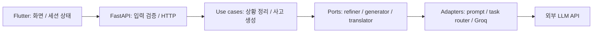

# Mind Builder

상황·감정·자동적 사고를 캐릭터와의 대화 흐름으로 정리하는 **CBT 기반 자기성찰 학습용 프로토타입**입니다. Flutter가 화면과 단계별 상태를 관리하고, FastAPI가 LLM 호출·응답 검증·오류 변환을 담당합니다.

개발 목적은 민감할 수 있는 입력을 다루는 외부 LLM API를 앱에 연결하면서, 화면과 백엔드의 책임·데이터 계약·실패 처리를 배우는 것입니다. 의료적 효과를 검증하지 않았으며 진단·치료를 제공하는 서비스로 설명하지 않습니다. 생성된 문장은 사용자가 검토하는 후보입니다.

## 주요 기능과 상태

| 영역 | 현재 구현 | 남은 범위 |
| --- | --- | --- |
| 대화 흐름 | 상황 → 감정 → 자동적 사고 → 인지 왜곡 → 도구 진행 | 세션 히스토리·사용자 계정·영속 저장 미구현 |
| 상황 정리 | FastAPI와 LLM으로 original/feedback/reframed 생성 | 실제 provider·모델 품질 미검증 |
| 자동적 사고 | 한국어 맥락 번역 → 생성 → 한국어 JSON 번역 | 세 차례 모델 호출의 지연·품질 평가 필요 |
| 자기성찰 도구 | 왜곡별 도구 연결 구조와 긍정적 재구성 흐름 | 나머지 도구·히스토리·인사이트는 향후 계획 |
| 오프라인 체험 | `lib/main_fake.dart`의 고정 모의 응답 | 실제 AI 응답이 아님 |
| 테스트 | Flutter의 모의 서비스 위젯 테스트, 백엔드의 응답/HTTP 실패 테스트 | 이번 환경에 Flutter SDK가 없어 위젯·빌드는 미검증 |

## 아키텍처와 기술 선택



| 경로 | 책임 |
| --- | --- |
| `lib/flow/cbt_session.dart` | 단계 이동과 현재 세션 상태 |
| `lib/features/` | 상황·감정·사고·왜곡·도구 UI |
| `lib/services/` | 백엔드 주소 선택과 HTTP 통신 |
| `backend/app/api/` | 요청 모델, 결과의 HTTP 변환 |
| `backend/app/application/` | 유스케이스, 외부 기능의 포트와 오류 타입 |
| `backend/app/infrastructure/` | Groq SDK, 작업별 모델 라우팅, 프롬프트, 번역 |
| `backend/app/schemas/`, `config.py`, `container.py` | 데이터 계약, 환경 설정, 의존성 조립 |
| `backend/tests/`, `test/` | 모의 LLM·API·위젯 테스트 |

Flutter는 하나의 UI 코드로 여러 플랫폼을 다루기 위해 사용합니다. FastAPI/Pydantic은 HTTP 요청과 모델 출력의 계약을 명시하기 위해 사용하고, Groq SDK는 LLM 호출을 연결합니다. 포트를 통해 유스케이스를 실제 API 없이 테스트합니다. 현재 백엔드에 DB 연동은 없으며, Flutter에도 DB 저장 구현은 없습니다. `pubspec.yaml`에 선언된 DB 관련 의존성은 실제 사용 전 정리·검토 대상입니다.

## 다룬 기술적 문제

**LLM의 JSON은 신뢰할 수 있는 API 응답이 아닙니다.** JSON 파싱 성공 뒤에도 루트 타입, 필수 필드, 문자열 타입, 공백 응답을 검증합니다. 자동적 사고 목록은 생성 결과뿐 아니라 번역 후 JSON도 같은 스키마로 검증하고 중복을 제거합니다. 숫자·null·객체를 임의 문자열로 바꾸지 않습니다.

**외부 오류를 앱의 HTTP 계약으로 바꿉니다.** 형식 검증 실패는 422, 유스케이스의 빈 입력은 400, 외부 API 오류·모델 결과 오류는 502, 설정·예기치 않은 내부 오류는 500입니다. 유스케이스를 조립하는 중의 오류도 처리 범위에 포함합니다. Groq 호출의 timeout은 30초, SDK 자동 재시도는 0으로 제한합니다. 이는 전체 HTTP 요청의 30초 완료를 보장하지 않으며, 사고 생성 경로는 모델을 세 번 호출합니다.

**대화 원문을 오류 메시지로 복사하지 않습니다.** API 응답과 애플리케이션 오류 로그는 고정 문구를 사용하며 upstream 예외 본문·traceback을 남기지 않습니다. 테스트는 합성 민감 문자열이 응답과 로그에 섞이지 않는지 검사합니다. 원인을 구분하는 로그는 유지하지만 운영용 request ID 등은 향후 과제입니다.

## 먼저 체험하기: 외부 API 없는 Flutter 모드

Dart SDK 조건은 `pubspec.yaml`의 `^3.11.0`입니다. 호환되는 Flutter SDK를 준비하고 저장소 루트에서 실행하세요.

```powershell
flutter pub get
flutter run -t lib/main_fake.dart
```

백엔드나 API 키 없이 화면 흐름을 체험하는 모드입니다. 이번 작업에서는 Flutter 실행을 확인하지 못했습니다.

## FastAPI 로컬 실행

Python 3.12, 저장소 루트의 PowerShell 기준입니다. macOS/Linux는 가상환경 실행 경로를 `.venv/bin/python`으로 바꾸세요.

```powershell
cd backend
python -m venv .venv
.venv/Scripts/python.exe -m pip install -r requirements-dev.txt
Copy-Item .env.example .env
# .env의 GROQ_API_KEY를 개인 개발 키로 설정
.venv/Scripts/python.exe -m uvicorn app.main:app --reload --host 127.0.0.1
```

모델·프롬프트·CORS 설정은 [backend/.env.example](backend/.env.example)에 있습니다. 모델 이름은 구성 예시이며 현재 계정에서의 사용 가능 여부는 직접 확인해야 합니다. 키는 Flutter 코드나 `--dart-define`에 넣지 않습니다.

- `GET http://127.0.0.1:8000/health`: `{"status":"ok"}`. provider 접속을 확인하는 readiness 검사는 아닙니다.
- `http://127.0.0.1:8000/docs`: 요청·응답 스키마
- `POST /api/situation/refine`, `POST /api/automatic-thoughts/generate`: [API 상세](backend/README.md)

실제 LLM 연결 앱은 루트에서 `flutter run`으로 실행합니다. Android 에뮬레이터는 기본 `http://10.0.2.2:8000`, 나머지 로컬 환경은 `http://127.0.0.1:8000`을 사용합니다. 실제 휴대폰의 localhost는 개발 PC를 가리키지 않으므로 별도 네트워크 설정이 필요합니다.

웹은 기본 CORS 허용 주소와 포트를 맞춥니다.

```powershell
flutter run -d chrome --web-port 7357 --dart-define=BACKEND_BASE_URL=http://127.0.0.1:8000
```

이 모드는 사용자 입력을 외부 LLM에 전송합니다. 공개 시연에는 합성 예시만 사용하세요. 인증·호출량 제한은 아직 없어 인터넷 공개 서버로 운영할 준비가 된 상태는 아닙니다.

## 테스트와 검사

```powershell
# backend/ 에서: 실제 API 키와 .env가 없어도 실행 가능
.venv/Scripts/python.exe -m pytest -q
.venv/Scripts/python.exe -m ruff check app tests --select E9,F63,F7,F82
.venv/Scripts/python.exe -m compileall -q app
```

백엔드 테스트는 모의 LLM과 인프로세스 HTTP를 사용하고 외부 네트워크 연결을 차단합니다. Windows asyncio 내부 통신을 위한 루프백 소켓은 허용합니다. 빈 응답, 배열/null/잘못된 JSON, 누락 필드·타입 오류, 번역 결과 오류, provider 장애, HTTP 상태·오류 노출을 검사합니다.

Flutter가 설치된 환경에서는 루트에서 `flutter analyze`, `flutter test`, `flutter build web`을 실행하세요. 이번 점검에서 이 세 명령은 실행하지 못했습니다.

## 한계와 다음 단계

- 실제 모델의 응답 품질·대화 적절성·긴 입력 지연은 평가하지 않았습니다.
- 프론트엔드 HTTP timeout, 잘못된 응답 타입의 UI 처리, 플랫폼별 빌드 검증이 필요합니다.
- 인증·요청량 제한·총 요청 시간 예산·관측성을 도입하기 전 외부 서비스로 배포하지 않습니다.
- 세션 영속 저장과 데이터 보관·삭제 정책은 미구현입니다. 실제 민감 대화로 시험하지 않습니다.
- 캐릭터 이미지와 참고 문서의 출처·사용 허가는 공개 전 확인이 필요합니다.

[자기성찰 도구 설계](docs/therapy-tools.md)와 [공개 전 보안 점검](SECURITY.md)을 참고하세요.
